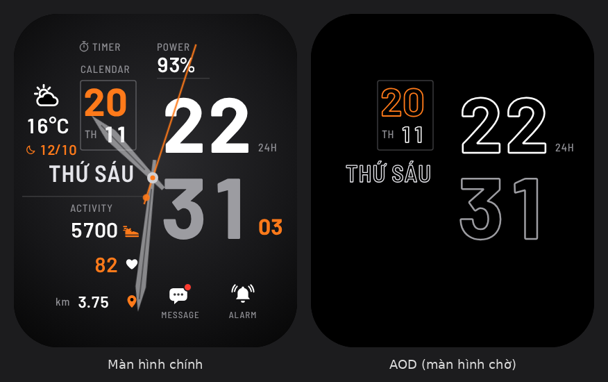

# Mặt đồng hồ "Hybrid Orange" – Huawei Watch Fit 5 Pro



Mặt lai (số + kim) theo các tiêu chí của mặt **Yellow Block**:
- **Thứ tiếng Việt** (THỨ HAI … CHỦ NHẬT), **ngày/tháng dạng số** (ô ngày: 20 / TH 11), **âm lịch** (biểu tượng trăng + 12/10) dưới nhiệt độ.
- **Số giờ/phút dày** (Barlow Bold): giờ trắng, phút xám, giây cam.
- **Kim giờ & phút trong suốt ~55%** nên vẫn đọc được số và chữ phía dưới; kim giây cam mảnh.
- **AOD** giữ đúng vị trí màn hình chính, dạng nét viền: chỉ thứ, ngày/tháng, giờ:phút – không giây, không kim (~6% điểm ảnh sáng).

Khung: **408 × 480 px**. Các bước chung (đăng ký nhà phát triển, cài Theme Studio, xuất `.hwt`, cài qua Huawei Health, bật AOD, xử lý sự cố) giống hệt mặt Yellow Block – xem [../fit5pro/HUONG-DAN-CAI-DAT.md](../fit5pro/HUONG-DAN-CAI-DAT.md) (Bước 0–3 và 6–8). Dưới đây là phần **khác** cho mặt này. Tọa độ = góc trên-trái ảnh.

## Bước 4 – Dựng màn hình chính

### 4.1 Nền
`assets/background.png` → X 0, Y 0 (đã có nền tối chuyển màu, ô ngày, nhãn, đường kẻ, chữ "TH", "/" âm lịch, "km", "24H", icon giày/tim/vị trí/trăng/bấm giờ/tin nhắn/báo thức).

### 4.2 Giờ số

| Thành phần | Ảnh (0→9) | X | Y |
|---|---|---|---|
| Giờ – chục / đơn vị | `time/hour_` | 212 / 278 | 116 |
| Phút – chục / đơn vị | `time/minute_` | 212 / 278 | 232 |
| Giây – chục / đơn vị | `time/sec_` | 352 / 370 | 290 |

Định dạng 24 giờ.

### 4.3 Kim (Pointer)
Thêm **Time → Analog / Pointer**. Mỗi kim là ảnh dựng đứng chỉ 12 giờ. **Tâm xoay trên màn hình: X 200, Y 236.**

| Kim | Ảnh | Kích thước | Tâm xoay trong ảnh (X, Y) |
|---|---|---|---|
| Kim giờ | `hands/hour.png` | 22 × 150 | 11, 128 |
| Kim phút | `hands/minute.png` | 18 × 222 | 9, 196 |
| Kim giây | `hands/second.png` | 12 × 250 | 6, 206 |
| Nắp tâm (đặt trên cùng) | `hands/cap.png` | 20 × 20 | đặt tại X 190, Y 226 |

Ảnh kim đã có sẵn độ trong suốt – **không** chỉnh thêm opacity trong Theme Studio (nếu muốn mờ hơn/đậm hơn, sửa số `0.55` trong hàm `hands()` của `src/generate.cjs`).

### 4.4 Lịch

| Thành phần | Ảnh | X | Y |
|---|---|---|---|
| Ngày – chục / đơn vị | `date/day_0..9` (cam) | 100 / 132 | 102 |
| Tháng – chục / đơn vị (số 01–12) | `date/month_0..9` | 128 / 146 | 158 |
| Thứ | `date/week_1_thu_hai` … `week_7_chu_nhat` | 28 | 204 |
| Ngày âm – chục / đơn vị | `date/lunar_0..9` | 36 / 48 | 184 |
| Tháng âm – chục / đơn vị | `date/lunar_0..9` | 67 / 79 | 184 |

Thứ tự ảnh thứ và lưu ý âm lịch: như mục 4.3 của hướng dẫn Yellow Block.

### 4.5 Dữ liệu

| Thành phần | Ảnh | X | Y | Căn |
|---|---|---|---|---|
| Pin (+ `num_pct`) | `data/num_0..9` | 206 | 58 | Trái |
| Icon thời tiết | `weather/*.png` (52×40) | 22 | 100 | – |
| Nhiệt độ (+ `num_c`, âm `num_minus`, trống `num_empty`) | `data/num_0..9` | 16 | 146 | Trái |
| Số bước | `data/num_0..9` | **150 = mép phải** | 296 | **Phải** |
| Nhịp tim (trống `numo_empty`) | `data/numo_0..9` (cam) | **150 = mép phải** | 346 | **Phải** |
| Quãng đường km (dấu thập phân `small_dot`) | `data/small_0..9` | 92 | 402 | Trái |

Gán icon thời tiết: giống bảng của Yellow Block (tên file như nhau, màu trắng).

### 4.6 Vùng chạm

| Mở | X | Y | Rộng × Cao |
|---|---|---|---|
| Bấm giờ (Timer) | 86 | 32 | 84 × 30 |
| Thời tiết | 10 | 94 | 80 × 86 |
| Hoạt động | 40 | 290 | 150 × 40 |
| Nhịp tim | 40 | 340 | 150 × 40 |
| Tin nhắn | 214 | 380 | 52 × 64 |
| Báo thức | 304 | 380 | 52 × 64 |

## Bước 5 – AOD

| Thành phần | Ảnh | X | Y |
|---|---|---|---|
| Nền AOD (ô ngày, "TH", "24H") | `aod/background_aod.png` | 0 | 0 |
| Giờ – chục / đơn vị | `aod/hour_0..9` | 212 / 278 | 116 |
| Phút – chục / đơn vị | `aod/minute_0..9` | 212 / 278 | 232 |
| Ngày – chục / đơn vị | `aod/day_0..9` | 100 / 132 | 102 |
| Tháng – chục / đơn vị | `aod/month_0..9` | 128 / 146 | 158 |
| Thứ | `aod/week_1_thu_hai` … `week_7_chu_nhat` | 28 | 204 |

Không thêm giây, kim, thời tiết, dữ liệu hay vùng chạm vào AOD.

## Kiểm tra trong Preview của Theme Studio
- Đặt giờ **10:08** và **14:45**: kim đè lên ô ngày / số giờ vẫn phải đọc được nhờ kim mờ.
- Thử **Chủ nhật** ("CHỦ NHẬT"), ngày **31/12**, bước **12345**, nhịp tim trống, nhiệt độ **−5°C**, quãng đường **12.50 km**.

## Sửa & xuất lại ảnh

```bash
node watchface/fit5pro-hybrid/src/generate.cjs
cd watchface/fit5pro-hybrid && zip -qr HybridOrange_Fit5Pro.zip assets HUONG-DAN-CAI-DAT.md preview*.png
```

Bố cục ở `src/layout.js`; nền, kim và ảnh thứ ở `src/generate.cjs`; font, icon và hàm vẽ dùng chung với `watchface/fit5pro/src/`. Mở `src/preview.html` để xem chạy giờ thật (bấm vào mặt để chuyển AOD).
