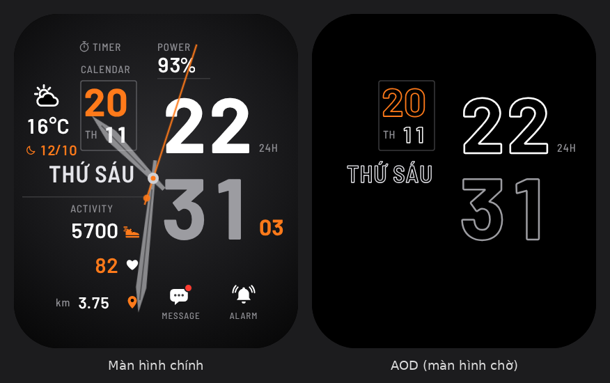

# Mặt đồng hồ "Hybrid Orange" – Huawei Watch Fit 5 Pro

Mặt lai số + kim: số giờ/phút dày, kim giờ/phút trong suốt, thứ tiếng Việt, ngày/tháng dạng số, âm lịch, AOD nét viền giữ nguyên bố cục.

- Hướng dẫn dựng & cài: **[HUONG-DAN-CAI-DAT.md](HUONG-DAN-CAI-DAT.md)**
- Gói ảnh để tải về: `HybridOrange_Fit5Pro.zip`
- Mã nguồn: `src/` (`layout.js`, `generate.cjs`, `preview.html`)
