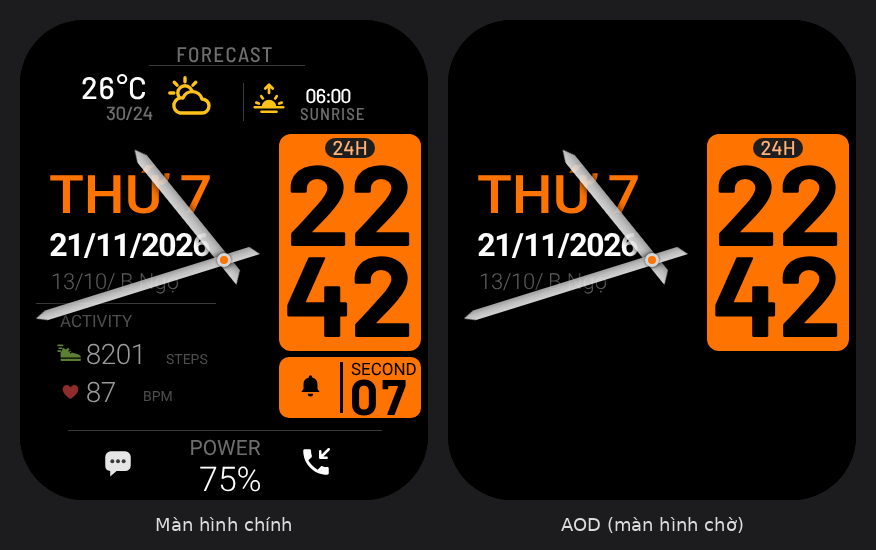

# Mặt đồng hồ "Orange Block" – Huawei Watch Fit 5 Pro



Dựng **đúng bố cục, cỡ chữ và màu của giao diện mẫu** (đo trực tiếp trên ảnh mẫu), chỉ thay đổi:
- **Thêm kim giờ & phút** (dáng kim bạc của mặt mẫu Hybrid) với **bóng đổ đậm** để nổi rõ trên cả nền đen lẫn khối cam. Tâm kim ở giữa màn hình (204, 240).
- **2 nét phân cách phía trên** (ngang dưới FORECAST và dọc giữa nhiệt độ / bình minh) đổi thành **mảnh 1px, mờ** giống hệt các nét bên dưới.
- **Thứ và ngày tháng năm thẳng 2 mép** trái/phải (chữ thứ được dãn/ép ngang, giữ nguyên chiều cao, nên mọi ngày từ THỨ 2 đến CHỦ NHẬT đều khớp mép).
- **Âm lịch nhỏ và mờ hơn** (13/10/ B Ngọ).
- **AOD giữ nguyên hình ảnh** màn hình chính (không chuyển nét viền): ô giờ/phút cam, thứ, ngày/tháng/năm, âm lịch và kim giờ/phút, cùng vị trí (~17% điểm ảnh sáng).

Font: Barlow (số giờ, giây, nhiệt độ, FORECAST, SUNRISE) và Roboto (thứ, ngày tháng năm, âm lịch, ACTIVITY, POWER…) – đúng như mẫu.

Khung **408 × 480 px**. Các bước chung (đăng ký nhà phát triển, cài Theme Studio, xuất `.hwt`, cài qua Huawei Health, bật AOD, xử lý sự cố) xem [../fit5pro/HUONG-DAN-CAI-DAT.md](../fit5pro/HUONG-DAN-CAI-DAT.md) (Bước 0–3 và 6–8). Tọa độ = góc trên-trái ảnh.

## Bước 4 – Màn hình chính

**Nền:** `assets/background.png` → X 0, Y 0 (đã có khối cam, nhãn 24H, khối giây + chuông + SECOND, FORECAST/SUNRISE/ACTIVITY/STEPS/BPM/POWER, các nét phân cách, dấu "/" của ngày và âm lịch, icon bình minh/giày/tim/tin nhắn/điện thoại).

### Giờ (24 giờ)

| Thành phần | Ảnh (0→9) | X | Y |
|---|---|---|---|
| Giờ – chục / đơn vị | `time/big_` (64×96) | 266 / 330 | 137 |
| Phút – chục / đơn vị | `time/big_` | 266 / 330 | 228 |
| Giây – chục / đơn vị | `time/sec_` (30×46) | 329 / 359 | 354 |

### Kim (Pointer) – tâm xoay trên màn hình **X 204, Y 240**

| Kim | Ảnh | Kích thước | Tâm xoay trong ảnh |
|---|---|---|---|
| Giờ | `hands/hour.png` | 44 × 201 | 22, 158 |
| Phút | `hands/minute.png` | 42 × 265 | 21, 213 |
| Nắp tâm (trên cùng) | `hands/cap.png` | 18 × 18 | đặt tại X 195, Y 231 |

Ảnh kim đã có sẵn bóng đổ và độ đậm – không chỉnh thêm opacity. Không có kim giây (giây hiện bằng số).

### Lịch

| Thành phần | Ảnh | X | Y |
|---|---|---|---|
| Thứ (THỨ 2 … THỨ 7, CHỦ NHẬT) | `date/week_1_thu_2` … `week_7_chu_nhat` (180×66) | 20 | 139 |
| Ngày – chục / đơn vị | `date/date_0..9` (17×36) | 30 / 47 | 206 |
| Tháng – chục / đơn vị | `date/date_0..9` | 76 / 93 | 206 |
| Năm – 4 chữ số | `date/date_0..9` | 122 / 139 / 156 / 173 | 206 |
| Ngày âm – chục / đơn vị | `date/lunar_0..9` (12×28) | 31 / 43 | 247 |
| Tháng âm – chục / đơn vị | `date/lunar_0..9` | 63 / 75 | 247 |
| Năm can chi ("B Ngọ") | `date/canchi_00_giap_ty` … `canchi_59_quy_hoi` | 99 | 245 |

**Năm can chi:** 60 ảnh viết tắt can như mẫu (G, Ất, B, Đ, M, K, C, T, N, Q + chi), số thứ tự = (năm âm − 4) chia lấy dư 60 (Bính Ngọ 2026 = `canchi_42`). Nếu Theme Studio không có thành phần năm âm lịch nhận ảnh, có thể bỏ ảnh này hoặc báo lại để in cố định lên nền.

### Thời tiết, hoạt động, pin

| Thành phần | Ảnh | X | Y | Căn |
|---|---|---|---|---|
| Nhiệt độ (+ `temp_c`, âm `temp_minus`) | `data/temp_0..9` | 61 | 52 | Trái |
| Cao / thấp (phân cách `hilo_slash`, âm `hilo_minus`) | `data/hilo_0..9` | 86 | 82 | Trái |
| Icon thời tiết | `weather/*.png` (56×48) | 143 | 55 | – |
| Giờ bình minh (dấu `sun_colon`) | `data/sun_0..9` | 286 | 64 | Trái |
| Số bước (trống `act_empty`) | `data/act_0..9` | 66 | 317 | Trái |
| Nhịp tim (trống `act_empty`) | `data/act_0..9` | 66 | 355 | Trái |
| Pin (+ `bat_pct`) | `data/bat_0..9` | 210 (tâm) | 440 | Giữa |

Icon thời tiết: `sunny`, `partly_cloudy`, `cloudy`, `rain`, `heavy_rain`, `thunder`, `snow`, `fog`, `wind`, `night`, `unknown` (gán như bảng của Yellow Block).

### Vùng chạm

| Mở | X | Y | Rộng × Cao |
|---|---|---|---|
| Thời tiết | 50 | 50 | 160 × 56 |
| Báo thức (chuông) | 259 | 337 | 61 × 61 |
| Hoạt động | 30 | 312 | 170 × 36 |
| Nhịp tim | 30 | 352 | 170 × 36 |
| Tin nhắn | 72 | 418 | 52 × 52 |
| Cuộc gọi | 270 | 418 | 52 × 52 |

## Bước 5 – AOD (giữ nguyên hình ảnh, cùng vị trí)

AOD dùng **chính các ảnh của màn hình chính**, chỉ khác ảnh nền:

| Thành phần | Ảnh | Vị trí |
|---|---|---|
| Nền AOD (khối cam giờ/phút + 24H, dấu "/" ngày và âm lịch; không có hàng thời tiết, hoạt động, khối giây) | `aod/background_aod.png` | X 0, Y 0 |
| Giờ, phút | `time/big_0..9` | như mục Giờ |
| Thứ, ngày/tháng/năm, âm lịch, can chi | `date/...` | như mục Lịch |
| Kim giờ, kim phút, nắp tâm | `hands/hour.png`, `hands/minute.png`, `hands/cap.png` | như mục Kim |

Không thêm giây, thời tiết, hoạt động hay vùng chạm vào AOD. Khối cam đặc sáng nhiều điểm ảnh hơn kiểu nét viền (~17% so với ~8%), nên AOD hao pin hơn một chút.

## Sửa & xuất lại ảnh

```bash
node watchface/fit5pro-orange/src/generate.cjs
cd watchface/fit5pro-orange && zip -qr OrangeBlock_Fit5Pro.zip assets HUONG-DAN-CAI-DAT.md preview*.png
```

- Độ đậm kim: `handAlpha` trong `src/layout.js` (1 = đặc).
- Màu cam: `colors.orange`; màu nét phân cách: `colors.line` trong `src/layout.js`.
- Mở `src/preview.html` để xem chạy giờ thật; bấm vào mặt để chuyển AOD.
