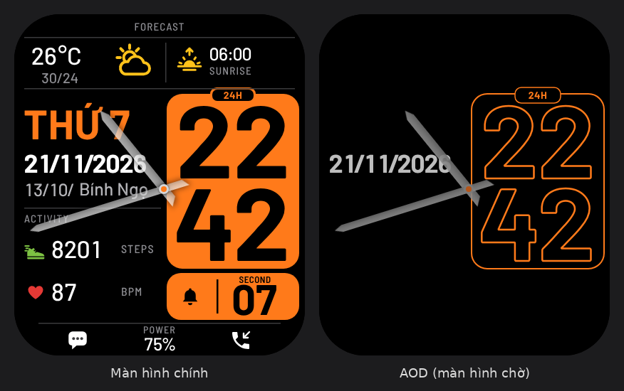

# Mặt đồng hồ "Orange Block" – Huawei Watch Fit 5 Pro

Khối giờ cam bên phải; thứ tiếng Việt, ngày/tháng/năm, âm lịch kèm năm can chi bên trái; kim giờ/phút có bóng đổ; bố cục gần tràn viền; AOD gồm ô giờ/phút, ngày/tháng/năm và kim.

- Hướng dẫn dựng & cài: **[HUONG-DAN-CAI-DAT.md](HUONG-DAN-CAI-DAT.md)**
- Gói ảnh để tải về: `OrangeBlock_Fit5Pro.zip`
- Mã nguồn: `src/` (`layout.js`, `generate.cjs`, `preview.html`); font/icon dùng chung với `../fit5pro/src/`
