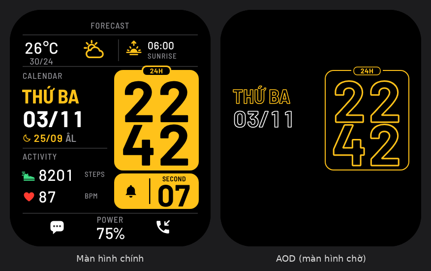

# Hướng dẫn dựng & cài mặt đồng hồ "Yellow Block" lên Huawei Watch Fit 5 Pro

> **Vì sao chưa có sẵn file `.hwt`?** File cài đặt `.hwt` chỉ tạo được bằng phần mềm **Huawei Theme Studio** (chạy trên Windows) và gắn với tài khoản nhà phát triển Huawei của bạn. Thư mục này đã có **đủ 100% ảnh + tọa độ**; bạn chỉ cần ráp vào Theme Studio theo các bước dưới (khoảng 30–45 phút) và xuất file.

Thông số màn hình Watch Fit 5 Pro: **408 × 480 px** (AMOLED 1,92"), đúng khung đã thiết kế.

---

## Bước 0 – Chuẩn bị

| Cần có | Ghi chú |
|---|---|
| Máy tính Windows 10/11 | Để chạy Huawei Theme Studio |
| Điện thoại Android cài **Huawei Health** | Đã ghép đôi với Watch Fit 5 Pro |
| Tài khoản **HUAWEI ID** | Dùng chung cho Theme Studio và Huawei Health |
| Bộ ảnh mặt đồng hồ | `watchface/fit5pro/YellowBlock_Fit5Pro.zip` (hoặc thư mục `assets/`) |

Tải bộ ảnh về máy tính: trên GitHub mở nhánh `claude/huawei-fit-5-pro-watchface-uwxj2g` → thư mục `watchface/fit5pro` → bấm `YellowBlock_Fit5Pro.zip` → **Download raw file**. Giải nén ra, ví dụ `D:\YellowBlock`.

## Bước 1 – Đăng ký nhà phát triển Huawei

1. Vào <https://developer.huawei.com> → **Register / Log in** bằng HUAWEI ID.
2. Hoàn tất **xác minh danh tính** (cá nhân: CCCD/hộ chiếu). Việc duyệt có thể mất 1–3 ngày làm việc.
3. (Chỉ khi muốn bán/đăng lên kho Huawei Themes) đăng ký thêm tư cách **nhà thiết kế Themes** trong mục Huawei Themes của trang developer.

## Bước 2 – Cài Huawei Theme Studio

1. Trên trang developer, tìm **Theme Studio** → tải bản Windows mới nhất → cài đặt.
2. Mở Theme Studio, đăng nhập bằng HUAWEI ID đã xác minh ở Bước 1.

## Bước 3 – Tạo dự án

1. **New project** → loại **Watch face**.
2. Chọn thiết bị **HUAWEI WATCH FIT 5 Pro**. Nếu danh sách chưa có, chọn dòng Watch Fit mới nhất có độ phân giải **408 × 480**.
3. Kiểu mặt: **Digital** (số). Tên: `Yellow Block`. Ảnh xem trước (cover): dùng `preview.png`.

Quy ước chung: mọi tọa độ dưới đây là **x, y của góc trên-trái** ảnh. Nhập đúng số vào ô *X / Y* trong bảng thuộc tính của từng thành phần.

## Bước 4 – Dựng màn hình chính

### 4.1 Nền
Thêm **Background** → chọn `assets/background.png` → X 0, Y 0.

### 4.2 Giờ – phút – giây (khối vàng bên phải)
Thêm **Time → Digital (image)**, định dạng **24 giờ**, mỗi chữ số một ô:

| Thành phần | Bộ ảnh (0→9) | X | Y |
|---|---|---|---|
| Giờ – chục | `time/big_0..9` | 226 | 140 |
| Giờ – đơn vị | `time/big_0..9` | 298 | 140 |
| Phút – chục | `time/big_0..9` | 226 | 228 |
| Phút – đơn vị | `time/big_0..9` | 298 | 228 |
| Giây – chục | `time/sec_0..9` | 300 | 352 |
| Giây – đơn vị | `time/sec_0..9` | 334 | 352 |

Khi chọn ảnh, chọn lần lượt 10 file theo đúng thứ tự 0, 1, …, 9.

### 4.3 Lịch (cột trái)

| Thành phần | Ảnh | X | Y |
|---|---|---|---|
| Thứ | `date/week_1_thu_hai` … `week_7_chu_nhat` | 24 | 146 |
| Ngày – chục / đơn vị | `date/day_0..9` | 26 / 53 | 200 |
| Tháng (số) – chục / đơn vị | `date/day_0..9` | 98 / 125 | 200 |
| Ngày âm – chục / đơn vị | `date/lunar_0..9` | 48 / 61 | 248 |
| Tháng âm – chục / đơn vị | `date/lunar_0..9` | 82 / 95 | 248 |

- **Thứ tự 7 ảnh thứ:** nếu Theme Studio yêu cầu bắt đầu từ **Chủ nhật**, đưa `week_7_chu_nhat` lên đầu, sau đó thứ Hai → thứ Bảy.
- Tháng chọn kiểu **số có 2 chữ số** (01–12) để khớp dấu "/" đã in sẵn trên nền.
- **Âm lịch:** chỉ thêm nếu Theme Studio có thành phần *Lunar date* dạng số cho thiết bị này. Nếu không có, báo lại để bỏ dòng âm lịch khỏi nền (biểu tượng trăng, "/" và "ÂL").

### 4.4 Thời tiết & bình minh (hàng trên)

| Thành phần | Ảnh | X | Y | Căn |
|---|---|---|---|---|
| Icon thời tiết | `weather/*.png` | 140 | 60 | – |
| Nhiệt độ hiện tại | `data/num_0..9`, dấu âm `num_minus`, đơn vị `unit_c`, không có dữ liệu `num_empty` | 30 | 60 | Trái |
| Cao / thấp | `data/gray_0..9`, phân cách `gray_slash`, dấu âm `gray_minus` | 40 | 94 | Trái |
| Giờ bình minh (nếu hỗ trợ) | `data/small_0..9`, dấu `small_colon` | 280 | 60 | Trái |

Gán icon cho từng loại thời tiết của Theme Studio:

| Thời tiết | Ảnh |
|---|---|
| Nắng | `sunny` |
| Ít mây | `partly_cloudy` |
| Nhiều mây / âm u | `cloudy` |
| Mưa nhỏ, mưa vừa, mưa rào | `rain` |
| Mưa to, mưa rất to | `heavy_rain` |
| Dông, sấm sét | `thunder` |
| Tuyết, mưa tuyết, mưa đá | `snow` |
| Sương mù, bụi, khói | `fog` |
| Gió mạnh, bão | `wind` |
| Trời quang ban đêm | `night` |
| Không rõ / chưa có dữ liệu | `unknown` |

### 4.5 Hoạt động & pin

| Thành phần | Ảnh | X | Y | Căn |
|---|---|---|---|---|
| Số bước | `data/num_0..9` | 58 | 318 | Trái |
| Nhịp tim | `data/num_0..9` (không có dữ liệu: `num_empty`) | 58 | 362 | Trái |
| Pin | `data/num_0..9` + `unit_pct` | 204 (tâm) | 436 | Giữa |

### 4.6 Vùng chạm (phím tắt)
Thêm **Hot zone / Jump** (vùng trong suốt, không cần ảnh):

| Mở ứng dụng | X | Y | Rộng × Cao |
|---|---|---|---|
| Tin nhắn | 70 | 418 | 52 × 48 |
| Cuộc gọi / Danh bạ | 286 | 418 | 52 × 48 |
| Báo thức | 222 | 340 | 56 × 56 |
| Nhịp tim | 20 | 356 | 130 × 44 |
| Hoạt động (bước) | 20 | 312 | 130 × 44 |
| Thời tiết | 20 | 54 | 190 × 56 |

## Bước 5 – Dựng màn hình AOD (luôn hiển thị)

Chuyển sang thẻ **AOD / Always On Display** của dự án. AOD **giữ đúng vị trí như màn hình chính** (thứ, ngày/tháng bên trái; khối giờ bên phải) để khi chuyển qua lại trông liền mạch. Chỉ có **thứ, ngày/tháng và giờ:phút – không có giây**, toàn bộ dạng **nét viền** nên chỉ ~7% điểm ảnh sáng (đỡ hao pin, tránh lưu ảnh màn AMOLED).

| Thành phần | Ảnh | X | Y |
|---|---|---|---|
| Nền AOD (viền khối giờ, nhãn 24H, dấu "/") | `aod/background_aod.png` | 0 | 0 |
| Thứ | `aod/week_1_thu_hai` … `week_7_chu_nhat` | 24 | 146 |
| Ngày – chục / đơn vị | `aod/date_0..9` | 26 / 53 | 200 |
| Tháng – chục / đơn vị | `aod/date_0..9` | 98 / 125 | 200 |
| Giờ – chục / đơn vị | `aod/time_0..9` | 226 / 298 | 140 |
| Phút – chục / đơn vị | `aod/time_0..9` | 226 / 298 | 228 |

Không thêm thành phần giây, thời tiết hay vùng chạm vào AOD.

## Bước 6 – Xem thử trong Theme Studio

1. Bấm **Preview**: đổi giờ (thử 00:00, 09:05, 23:59), đổi thứ (thử **Chủ nhật** để kiểm tra chữ "CHỦ NHẬT"), đổi ngày 31/12.
2. Thử dữ liệu: bước 99999, nhịp tim trống, pin 100%, nhiệt độ âm (−5°C).
3. Bật chế độ AOD trong preview, kiểm tra không có giây.
4. Nếu Theme Studio báo lỗi kích thước ảnh, kiểm tra lại đã chọn đúng thiết bị 408 × 480.

## Bước 7 – Xuất file `.hwt`

1. **Export / Package** → điền tên, tác giả, mô tả (VD: "Mặt số vàng 24H, lịch âm, tiếng Việt").
2. Lưu ra file, ví dụ `YellowBlock.hwt`.

## Bước 8 – Cài lên đồng hồ

1. Chép `YellowBlock.hwt` sang điện thoại Android (cáp USB hoặc Google Drive → tải về thư mục *Download*).
2. Mở **Huawei Health**, đăng nhập **đúng HUAWEI ID đã đăng ký nhà phát triển** ở Bước 1. Với ID khác, Health sẽ không cho nạp file tự tạo.
3. Vào **Thiết bị** → chọn **HUAWEI WATCH FIT 5 Pro** → **Mặt đồng hồ (Watch faces)** → nạp gói mặt đồng hồ từ bộ nhớ máy → chọn `YellowBlock.hwt` → **Cài đặt**. Huawei mô tả bước này trong mục *Test the watch face on your watch* của [codelab Watch Face](https://developer.huawei.com/consumer/en/codelab/theme-Watchface/index.html); tên nút có thể khác chút tùy phiên bản Health.
4. Giữ điện thoại gần đồng hồ, Bluetooth bật, đến khi báo cài xong → chọn **Đặt làm mặt mặc định**.

### Bật AOD trên đồng hồ
Trên đồng hồ: **Cài đặt → Màn hình & độ sáng → Luôn bật màn hình (Always On Display)** → bật. Khi hạ tay, đồng hồ chuyển sang AOD: cùng bố cục, chỉ còn nét viền của thứ, ngày/tháng và giờ:phút.

## Xử lý sự cố

| Hiện tượng | Cách xử lý |
|---|---|
| Kẹt ở "Đang cài đặt" | Bluetooth chập chờn: để điện thoại sát đồng hồ, chờ hoặc thử lại |
| Báo thiếu bộ nhớ / đủ số mặt | Xóa bớt mặt đồng hồ ít dùng rồi cài lại |
| Vẫn không cài được | Trong Health hủy ghép đôi đồng hồ, ghép lại, rồi cài lại |
| Không thấy mục nạp file | Kiểm tra Health đang đăng nhập đúng ID nhà phát triển và đã cập nhật bản mới |
| Thứ/tháng hiện sai | Thứ tự ảnh chọn trong Theme Studio bị lệch (xem 4.3) |

Nguồn: [Huawei Codelab – Watch Face](https://developer.huawei.com/consumer/en/codelab/theme-Watchface/index.html) · [Huawei hỗ trợ – không cài được mặt đồng hồ](https://consumer.huawei.com/uk/support/content/en-gb15838102) · [Thông số Watch Fit 5 Pro](https://consumer.huawei.com/en/wearables/watch-fit5-pro/specs/)
