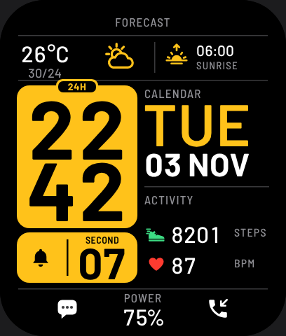

# Mặt đồng hồ "Yellow Block" – Huawei Watch Fit 5 Pro



Bộ ảnh và bố cục dựng theo mẫu: khối giờ vàng 24H, ô giây kèm chuông báo thức, cột phải hiển thị thứ/ngày/tháng và hoạt động (bước chân, nhịp tim), hàng trên thời tiết + bình minh, hàng dưới pin + 2 phím tắt (tin nhắn, cuộc gọi).

- Khung thiết kế: **408 × 480 px** (cùng tỷ lệ màn hình dòng Watch Fit). Nếu Theme Studio báo độ phân giải khác cho Fit 5 Pro, sửa `screen` trong `src/layout.js` rồi chạy lại lệnh xuất ảnh.
- Phông chữ: Barlow / Barlow Semi Condensed (giấy phép SIL OFL, dùng thương mại được).

## Cấu trúc

| Thư mục | Nội dung |
|---|---|
| `assets/background.png` | Nền tĩnh (đã gồm khung vàng, nhãn, đường kẻ, icon chuông/giày/tim/tin nhắn/điện thoại/bình minh) |
| `assets/time/big_0..9.png` | Số giờ & phút (đen, 72×92) |
| `assets/time/sec_0..9.png` | Số giây (đen, 34×50) |
| `assets/date/week_1_MON … week_7_SUN.png` | Thứ (vàng, 180×66) |
| `assets/date/day_0..9.png` | Số ngày (trắng, 27×42) |
| `assets/date/month_01_JAN … month_12_DEC.png` | Tháng (trắng, 116×42) |
| `assets/data/num_0..9.png` + `unit_c`, `unit_pct`, `num_minus`, `num_empty` | Số trắng cho nhiệt độ, bước, nhịp tim, pin (18×34) |
| `assets/data/gray_0..9.png` + `gray_slash`, `gray_minus` | Nhiệt độ cao/thấp (xám, 10×20) |
| `assets/data/small_0..9.png` + `small_colon` | Giờ bình minh (trắng, 12×24) |
| `assets/weather/*.png` | 11 icon thời tiết vàng (64×46) |
| `src/` | Mã nguồn: `layout.js` (tọa độ), `icons.js`, `generate.cjs` (xuất ảnh), `preview.html` (xem thử chạy giờ thật) |

## Tọa độ đặt trong Theme Studio (x, y = góc trên-trái)

| Phần tử | Ảnh | x | y | Căn |
|---|---|---|---|---|
| Nền | background.png | 0 | 0 | – |
| Giờ – chục / đơn vị | time/big_ | 38 / 110 | 140 | – |
| Phút – chục / đơn vị | time/big_ | 38 / 110 | 228 | – |
| Giây – chục / đơn vị | time/sec_ | 112 / 146 | 352 | – |
| Thứ | date/week_ | 204 | 146 | – |
| Ngày – chục / đơn vị | date/day_ | 206 / 233 | 214 | – |
| Tháng | date/month_ | 268 | 214 | – |
| Nhiệt độ hiện tại (+ °C) | data/num_ | 30 | 60 | Trái |
| Nhiệt độ cao / thấp | data/gray_ | 40 | 94 | Trái |
| Icon thời tiết | weather/ | 140 | 60 | – |
| Giờ bình minh | data/small_ | 280 | 60 | Trái |
| Số bước | data/num_ | 244 | 318 | Trái |
| Nhịp tim | data/num_ | 244 | 362 | Trái |
| Pin (+ %) | data/num_ | 204 (tâm) | 436 | Giữa |
| Vùng chạm tin nhắn | – | 78 | 424 | 36×36 |
| Vùng chạm cuộc gọi | – | 294 | 424 | 34×34 |
| Vùng chạm báo thức | – | 42 | 352 | 32×32 |

## Các bước làm trong Huawei Theme Studio

1. Đăng ký tài khoản nhà phát triển Huawei, tải **Huawei Theme Studio** (Windows) → *New Project* → *Watch Face* → chọn thiết bị **HUAWEI WATCH FIT 5 Pro** (nếu chưa có thì chọn dòng Fit mới nhất cùng độ phân giải).
2. Kéo `background.png` vào lớp nền.
3. Thêm thành phần **Time** → kiểu *Digital, ảnh rời*: gán bộ `big_0..9` cho giờ, phút; `sec_0..9` cho giây; đặt tọa độ theo bảng. Chọn định dạng 24 giờ.
4. Thêm **Date**: Week → 7 ảnh `week_1_MON` … `week_7_SUN` (kiểm tra thứ tự Theme Studio yêu cầu – nếu bắt đầu từ Chủ nhật thì đưa SUN lên đầu); Day → `day_0..9`; Month → 12 ảnh tháng.
5. Thêm **Data**: Steps, Heart rate, Battery dùng `num_0..9`; Weather → icon + nhiệt độ (`num_`, đơn vị `unit_c`, dấu âm `num_minus`) và cao/thấp (`gray_`, phân cách `gray_slash`); Sunrise (nếu thiết bị hỗ trợ) dùng `small_`.
6. Gán icon thời tiết theo từng mã của Theme Studio: nắng → `sunny`, ít mây → `partly_cloudy`, nhiều mây/âm u → `cloudy`, mưa nhỏ/vừa → `rain`, mưa to → `heavy_rain`, dông → `thunder`, tuyết/mưa tuyết → `snow`, sương mù/bụi → `fog`, gió → `wind`, đêm quang → `night`, còn lại → `unknown`.
7. Thêm vùng chạm (Shortcut/Jump) cho tin nhắn, cuộc gọi, báo thức theo bảng.
8. (Tuỳ chọn) Màn hình chờ AOD: dùng `background_transparent.png` làm gợi ý, chỉ giữ giờ/phút để tiết kiệm pin.
9. *Preview* → *Export* file `.hwt` → cài lên đồng hồ qua Theme Studio hoặc gửi duyệt lên Huawei Themes.

## Sửa giao diện & xuất lại ảnh

```bash
node watchface/fit5pro/src/generate.cjs
```

Lệnh xuất lại toàn bộ `assets/` và `preview.png`. Mở `src/preview.html` trong trình duyệt để xem chạy theo giờ thật (thêm `?static=1` để giữ 22:42:07).
Đổi màu ở `colors`, đổi vị trí ở `widgets`, đổi cỡ chữ ở `digitSets` trong `src/layout.js`; nhãn và nền tĩnh nằm trong hàm `background` của `generate.cjs`.
